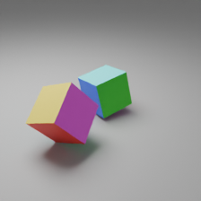
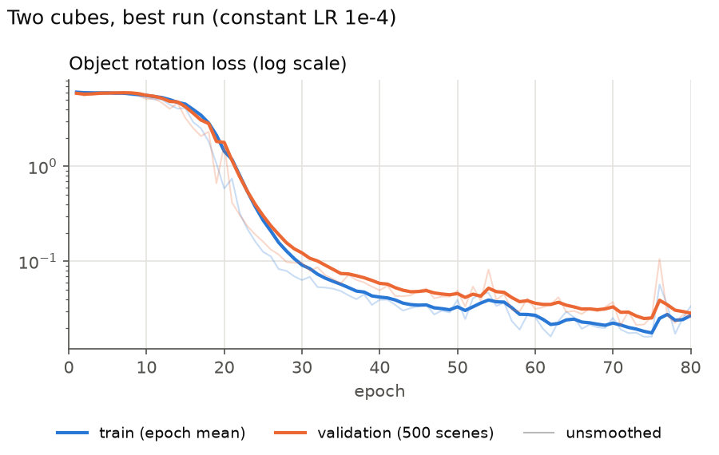
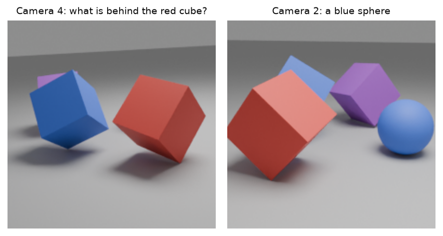

# Text from 3D

**Answering spatial questions about a 3D scene from several views of it.**

A personal project to learn how to build a vision-language model (VLM) from
scratch. Scenes of simple objects are rendered with Blender from eight cameras.

The project has two stages:

1. **Multi-view reconstruction.** An exploratory stage: can a DETR-style model
   [1] recover a 3D scene from several views? It shows what is achievable
   with this setup before defining a harder task.
2. **Multi-view visual question answering.** A task suited to a VLM, inspired
   by CLEVR [2], but whose questions need several views to be answered, for
   instance because an object is hidden in one of them.

---

## 1. Multi-view reconstruction (DETR)

**Model.** A frozen DINOv2 [3] encodes each view, a transformer fuses the
views, and object queries predict each object's class and pose. Hungarian
matching pairs predictions with targets during training
([src/models/vision](src/models/vision)).

**Experiment.** A feasibility test for multi-view inverse graphics, on a
deliberately simple dataset: two cubes, eight fixed cameras, 5,000 training
scenes. Each cube face always has the same colour, so a cube's rotation is
never ambiguous.

**Result.** After a long plateau, the model learns the rotation and reaches a
validation error of about 6° per cube, with no overfitting. This is a proof
of concept: the error can most likely go much lower.

  

Run details and comparison: [docs/two_cubes.md](docs/two_cubes.md).

**Further experiments.** The setup was then extended beyond identical cubes:
spheres and cylinders, a per-axis scale term to model boxes rather than cubes,
rotation losses invariant to each shape's symmetries (none for spheres, the
axis only for cylinders, the cube group for boxes), and cameras placed at
random, whose poses the model also predicts.

---

## 2. Multi-view visual question answering

### 2.1 Dataset

About 10,000 training and 1,000 validation scenes, each with 3 to 4 objects
(cubes, spheres, cylinders; six colours) seen from eight cameras placed at
random around the scene. Every scene contains at least two pairs of objects
where one hides the other from some camera. Each scene comes with 16
CLEVR-style templated questions, grouped by skill: viewpoint relations,
visibility and occlusion, camera layout, perspective taking and metric
comparisons.

Example: *From camera 4, which object is hidden behind the red
cube?* The sphere is invisible from camera 4; camera 2 shows that it is a
**blue sphere**.

### 2.2 VLM — work in progress

**Architecture.** The model follows MDETR [4], a good fit for this task. The
questions are short and templated, and most answers are one or two words, so
the difficulty lies less in generating text than in grounding the question in
the scene: which objects it refers to, what each camera sees, and how the
views relate. MDETR fuses text and image features early, in a shared
transformer, so that the question conditions the object queries directly. It
also extends naturally the DETR-style model of stage 1, whose visual tokens
and object queries it reuses. The question is encoded by a bidirectional,
BERT-style text encoder [5], which I plan to train myself from scratch; this
training is in progress ([src/models/mdetr](src/models/mdetr)).

This section reflects ongoing work, not settled results, and will be updated
as results come in.

---

## Bibliography

1. Carion et al. *End-to-End Object Detection with Transformers* (DETR). ECCV 2020. [arXiv:2005.12872](https://arxiv.org/abs/2005.12872)
2. Johnson et al. *CLEVR: A Diagnostic Dataset for Compositional Language and Elementary Visual Reasoning*. CVPR 2017. [arXiv:1612.06890](https://arxiv.org/abs/1612.06890)
3. Oquab et al. *DINOv2: Learning Robust Visual Features without Supervision*. TMLR 2024. [arXiv:2304.07193](https://arxiv.org/abs/2304.07193)
4. Kamath et al. *MDETR — Modulated Detection for End-to-End Multi-Modal Understanding*. ICCV 2021. [arXiv:2104.12763](https://arxiv.org/abs/2104.12763)
5. Devlin et al. *BERT: Pre-training of Deep Bidirectional Transformers for Language Understanding*. NAACL 2019. [arXiv:1810.04805](https://arxiv.org/abs/1810.04805)
