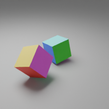

# Text from 3D

**From multiple images to a structured description of a 3D scene.**

The goal is to reconstruct a simple Blender-generated scene from several views and describe it in text: which objects are present, their positions, rotations and scales, and the positions and orientations of the cameras. Positions and rotations are expressed relative to the first camera.

This is an ongoing personal project exploring how much 3D scene information can be recovered from multiple images. The current prototype uses a DETR-based architecture to test the feasibility of the approach and assess which object and camera attributes can be extracted across different scenes. The long-term goal is to build a vision-language model (VLM) that generates textual descriptions of a scene from its views.

## Approach

For these initial experiments, the model predicts structured attributes using a DETR-based architecture:

1. A frozen **DINOv2 visual encoder** extracts features from each image.
2. A **multi-view encoder** uses attention to combine information across views, with embeddings identifying each camera and image patch position.
3. Learned **object queries** attend to these shared features. Each query acts as a prediction slot for an object, estimating its type, position, scale and rotation, or predicting that no object is present. Hungarian matching pairs predictions with the target objects during training, so objects do not need a predefined order.

A separate camera decoder predicts camera positions and orientations from the same shared features.

## First results

*Example view from a Blender-generated dataset. Distinct face colors provide visual cues for object orientation in the initial experiments.*

The initial feasibility experiments use synthetic scenes with randomized object positions and rotations, rendered from **eight fixed cameras** at 224 × 224 pixels per view. Controlled scene generation provides ground-truth object and camera attributes for quantitative evaluation.

An initial cube experiment reached an **object rotation error of approximately 8°**. This is an encouraging preliminary result under controlled conditions; it does not yet establish generalization to other object types or unseen camera configurations.

## Work in progress

Current work focuses on extending the experiments to more object types without requiring a distinct color on every face. This requires accounting for rotational symmetries: different orientations can produce the same appearance, so supervision and evaluation should reflect what is visually identifiable. Another next step is to train and evaluate with randomly varied camera positions and orientations; camera poses remain fixed in the initial experiments.
