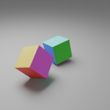
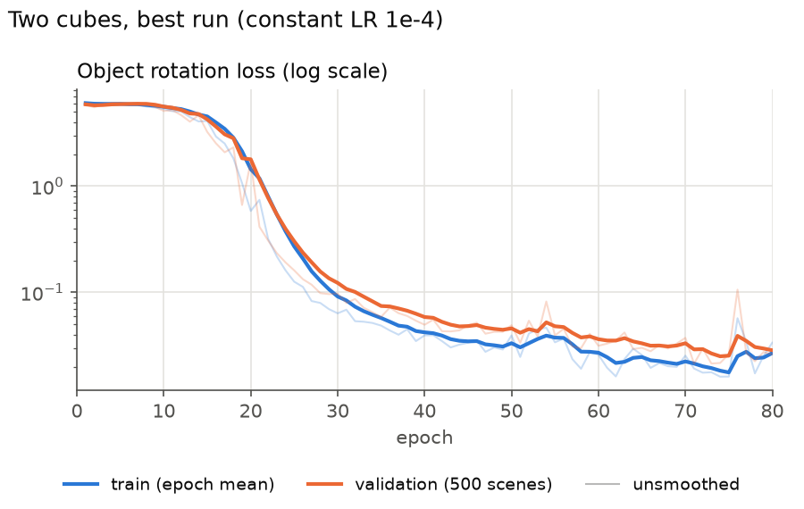
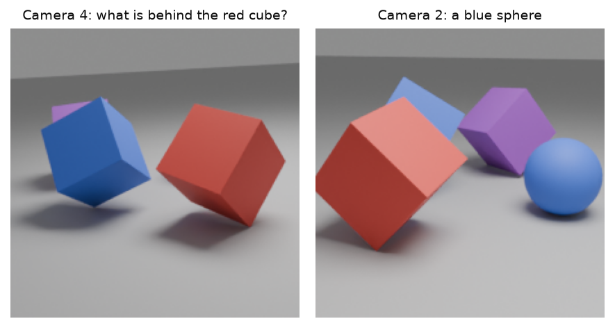

# Text from 3D

**Answering spatial questions about a 3D scene from several views of it.**

A personal project to learn how to build a vision-language model (VLM) from
scratch. Scenes of simple objects are rendered with Blender from eight cameras.

The project has two stages:

1. **Multi-view reconstruction.** An exploratory stage: can a DETR-style model
   [1] recover a 3D scene from several views? It shows what is achievable
   with this setup before defining a harder task.
2. **Multi-view visual question answering.** A task suited to a VLM, inspired
   by CLEVR [2], but whose questions need several views to be answered, for
   instance because an object is hidden in one of them.

---

## 1. Multi-view reconstruction (DETR)

**Model.** A frozen DINOv2 [3] encodes each view, a transformer fuses the
views, and object queries predict each object's class and pose. Hungarian
matching pairs predictions with targets during training
([src/models/vision](src/models/vision)).

**Experiment.** A feasibility test for multi-view inverse graphics, on a
deliberately simple dataset: two cubes, eight fixed cameras, 5,000 training
scenes. Each cube face always has the same colour, so a cube's rotation is
never ambiguous.

**Result.** After a long plateau, the model learns the rotation and reaches a
validation error of about 6° per cube, with no overfitting. This is a proof
of concept: the error can most likely go much lower.

  

Run details and comparison: [docs/two_cubes.md](docs/two_cubes.md).

**Further experiments.** The setup was then extended beyond identical cubes:
spheres and cylinders, a per-axis scale term to model boxes rather than cubes,
rotation losses invariant to each shape's symmetries (none for spheres, the
axis only for cylinders, the cube group for boxes), and cameras placed at
random, whose poses the model also predicts.

---

## 2. Multi-view visual question answering

### 2.1 Dataset

About 10,000 training and 1,000 validation scenes, each with 3 to 4 objects
(cubes, spheres, cylinders; six colours) seen from eight cameras placed at
random around the scene. Every scene contains at least two pairs of objects
where one hides the other from some camera. Each scene comes with 16
CLEVR-style templated questions, grouped by skill: viewpoint relations,
visibility and occlusion, camera layout, perspective taking and metric
comparisons.

Example: *From camera 4, which object is hidden behind the red
cube?* The sphere is invisible from camera 4; camera 2 shows that it is a
**blue sphere**.

### 2.2 Language model

A 96M-parameter GPT (8 layers, 8 heads, width 768, 1,024-token context,
SwiGLU feed-forward, GPT-2 tokenizer), trained from scratch on 1.9B tokens of
FineWeb-Edu [4], about 20 tokens per parameter. One epoch takes 58,629 steps of
32,768 tokens on a single RTX 4000 Ada, for a final validation loss of 3.48.
The code is strongly inspired by Andrej Karpathy's nanochat [5] and his
lecture series ([src/models/language](src/models/language)).

### 2.3 VLM — in progress

The current step is a Flamingo-style VLM [6]: gated cross-attention layers,
inserted between the GPT blocks, read the visual tokens of the vision model. The
goal is a first baseline on the questions of 2.1
([src/models/vlm](src/models/vlm)).

Training instructions: [src/README.md](src/README.md).

---

## Bibliography

1. Carion et al. *End-to-End Object Detection with Transformers* (DETR). ECCV 2020. [arXiv:2005.12872](https://arxiv.org/abs/2005.12872)
2. Johnson et al. *CLEVR: A Diagnostic Dataset for Compositional Language and Elementary Visual Reasoning*. CVPR 2017. [arXiv:1612.06890](https://arxiv.org/abs/1612.06890)
3. Oquab et al. *DINOv2: Learning Robust Visual Features without Supervision*. TMLR 2024. [arXiv:2304.07193](https://arxiv.org/abs/2304.07193)
4. Penedo et al. *The FineWeb Datasets: Decanting the Web for the Finest Text Data at Scale*. NeurIPS 2024. [arXiv:2406.17557](https://arxiv.org/abs/2406.17557)
5. Karpathy. *nanochat*. 2025. [github.com/karpathy/nanochat](https://github.com/karpathy/nanochat)
6. Alayrac et al. *Flamingo: a Visual Language Model for Few-Shot Learning*. NeurIPS 2022. [arXiv:2204.14198](https://arxiv.org/abs/2204.14198)
