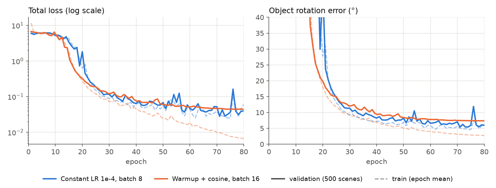

# Two cubes: first multi-view pose experiment

**Task.** Each scene holds two cubes whose faces have distinct colours, rendered
from 8 cameras. The vision model ([src/models/vision](../src/models/vision))
predicts each cube's class, position, scale and rotation, and each camera's pose.
Dataset: 5,000 training scenes and 500 validation scenes.

**Model.** Frozen DINOv2-small encoder, 8-layer multi-view transformer
(d_model = 256), 4-layer object decoder with 5 queries, Hungarian matching.
AdamW, bf16, 80 epochs.

| Run | Schedule | Batch | Camera decoder | Steps | Val. rotation error (best / final) | Train rotation error (last epoch) |
|---|---|---|---|---|---|---|
| `two_cubes_lr_1e-4/run_3` | constant 1e-4 | 8 | 4 layers | 50,000 | **5.4° / 6.0°** | 6.4° |
| `two_cubes_cosine/run_1` | 750-step warmup, cosine 1e-4 → 3e-6 | 16 | 1 layer | 25,040 | 7.4° / 7.4° | 2.8° |

Both runs match objects to targets perfectly on validation (100%), and the
camera rotation error is about 0.1°. Runs `run_1` and `run_2` of
`two_cubes_lr_1e-4` stopped after about 250 steps (disk quota) and are left out.

## Takeaways

- **Long plateau, then a sharp drop.** For roughly 15–20 epochs, the rotation
  error stays near chance while the position and camera losses already fall.
  Then it drops quickly. The plateau is shorter in steps with the cosine run
  (~4,700 against ~12,500).
- **The cosine schedule smooths training but overfits.** The validation curve
  is smooth instead of spiking (epochs 54, 76 in the constant-LR run). But the
  training error keeps falling to 2.8° while validation stays at 7.4°. The
  constant-LR run, noisier, keeps train ≈ validation and ends lower.
- **Not a clean ablation.** The two runs differ in schedule, batch size, number
  of steps and camera decoder depth at the same time. The gap in validation
  error cannot be attributed to the schedule alone.
- **Open question: what limits the error at 5–7°?** Two hypotheses, untested
  here: the 14-pixel DINOv2 patches limit angular precision, or 5,000 scenes are
  too few (the cosine run's train/validation gap points to the latter).

Regenerate the figure: `python scripts/plot_two_cubes.py` (needs the runs
pulled locally into `runs/`).
